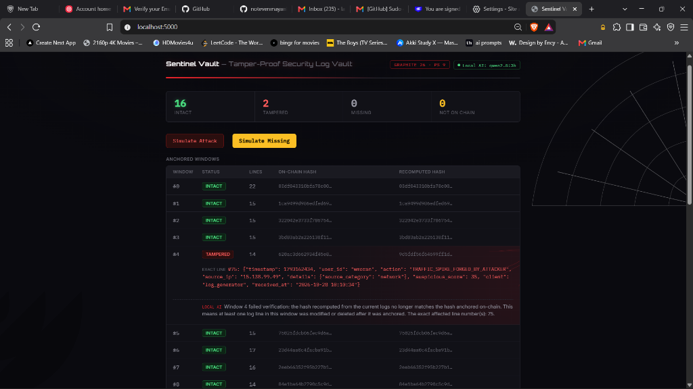
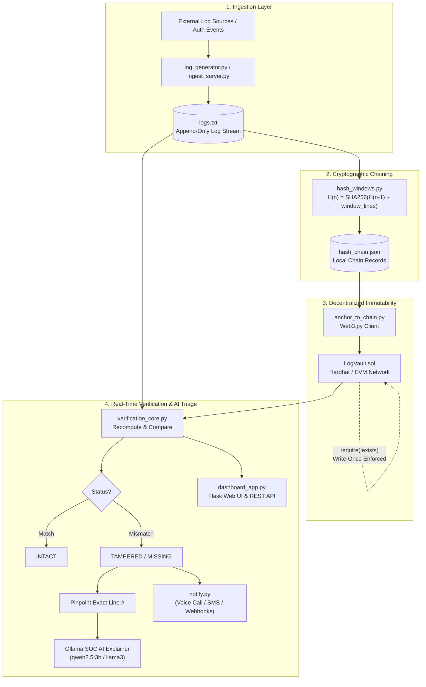

# 🛡️ Sentinel Vault (LogVault)

<p align="center">
  <strong>Tamper-Proof Security Log Vault with Blockchain Anchoring & AI Forensic Triage</strong>
</p>

<p align="center">
  
  
  
  
  
  
</p>

---

## 🌟 Overview

**Sentinel Vault** is an immutable, enterprise-grade security log management system engineered to neutralize insider threats, unauthorized log tampering, and forensic evasion. By combining **SHA-256 cryptographic hash-chaining**, **on-chain Ethereum smart contract anchoring**, and **local offline LLM forensics (Ollama)**, Sentinel Vault guarantees that any unauthorized modification, deletion, or insertion in audit logs is immediately detected and pinpointed down to the exact line number.

<p align="center">
  
</p>

---

## 📸 Live Operational Dashboard & Tamper Detection

When an attacker attempts to alter historical audit trails (e.g., erasing brute-force records or forging traffic metrics), Sentinel Vault's independent verification engine flags the incident in real-time, displays the cryptographic hash divergence, isolates the compromised line, and triggers an AI forensic triage.

<p align="center">
  
</p>

### 🔍 Forensic Highlights Captured in Dashboard:
- **Zero-Trust Chain Status**: Live aggregation of `INTACT`, `TAMPERED`, `MISSING`, and `NOT ON CHAIN` windows.
- **Microsecond Discrepancy Detection**: Instant recomputation of log hashes compared directly against immutable on-chain state.
- **Line-Level Pinpointing**: Isolates the exact line (e.g., `Line #75: TRAFFIC_SPIKE_FORGED_BY_ATTACKER`) with original line indices.
- **On-Premise SOC AI Explainer**: Offline LLM (`qwen2.5:3b` / `llama3`) analyzes context and generates actionable triage notes without leaking sensitive logs to external APIs.

---

## ⚡ Key Features

- **⛓️ Continuous Cryptographic Chaining**: Each window hash is derived from the current log records plus the prior window's hash ($H_n = \text{SHA256}(H_{n-1} + \text{lines}_n)$). An attacker cannot forge an earlier window without invalidating every subsequent link.
- **🔒 Immutable Blockchain Anchoring**: Log window hashes are anchored into an Ethereum-compatible smart contract (`LogVault.sol`). The contract strictly enforces `require(!windows[windowId].exists)`, preventing even root administrators or contract deployers from overwriting anchored hashes.
- **🎯 Exact Line-Level Isolation**: Granular per-line hash tracking enables the verification core to pinpoint the exact 1-indexed line modified, injected, or dropped.
- **🤖 Autonomous SOC AI Agent**: Integrated with local Ollama instances to translate raw hash mismatches into plain-English incident response summaries.
- **🚨 Multi-Channel Incident Alerting**: Real-time dispatch engine supporting automated Twilio voice calls, SMS, and webhook notifications upon verified tampering.
- **🛡️ Secure Access & Cloud Sync**: Built-in authentication module (`auth.py`) backed by SQLite and scrypt/pbkdf2 hashing, alongside an off-site cloud sync utility for distributed backups.

---

## 🔄 Architecture & Data Flow



---

## 🛠 Tech Stack

| Domain | Technology | Description |
|---|---|---|
| **Core Engine** | Python 3.12+ | High-performance log parsing, hashing, and verification logic |
| **Smart Contracts** | Solidity (`^0.8.28`) | Immutable storage contract (`LogVault.sol`) with strict write-once semantics |
| **Blockchain Devnet** | Hardhat | Local EVM blockchain development and simulation network |
| **Web3 Client** | Web3.py | JSON-RPC bridge for contract interaction and on-chain verification |
| **Web Framework** | Flask 3.1 & Flask-CORS | REST API and dynamic operational dashboard |
| **Local AI Triage** | Ollama (`qwen2.5`, `llama3`) | On-premise, zero-data-leak incident triage analysis |
| **Cryptography** | Hashlib (SHA-256) | Window chaining and per-line integrity fingerprints |
| **Database** | SQLite 3 + Werkzeug | User authentication store with secure password hashing |
| **Telemetry / Alerting** | Twilio & Webhooks | Multi-channel automated notifications on tamper detection |
| **Synthetic Ingestion** | Faker | Multi-vector security event generator |

---

## 📂 Repository Structure

```
Logvault/
├── assets/                     # UI screenshots and project media
│   ├── sentinel-vault-landing.jpg    # Modern landing page showcase
│   └── sentinel-vault-dashboard.png  # Live tamper-detection dashboard
├── blockchain/                 # Hardhat smart contract development suite
│   ├── contracts/
│   │   └── LogVault.sol        # Solidity immutable log anchor contract
│   ├── deploy.py               # Automated Web3 contract deployment script
│   ├── hardhat.config.ts       # Hardhat network configuration
│   └── package.json            # Node.js dependencies for EVM tooling
├── templates/
│   └── dashboard.html          # Jinja2 dashboard with real-time HUD and stats
├── anchor_to_chain.py          # Bridges sealed local windows to smart contract
├── ARCHITECTURE.md             # Detailed cryptographic & blockchain rationale
├── auth.py                     # SQLite authentication blueprint (/api/auth)
├── cloud_sync.py               # Off-site encrypted backup & synchronization
├── dashboard_app.py            # Primary Flask application (Port 5000)
├── hash_windows.py             # Log batch processor and SHA-256 window chainer
├── ingest_server.py            # Microservice accepting external JSON log streams
├── live_demo.py                # End-to-end interactive demo script
├── log_generator.py            # Background synthetic enterprise log producer
├── mcp_server.py               # Model Context Protocol interface for AI agents
├── notify.py                   # Twilio SMS / Voice and Webhook dispatcher
├── ollama_explainer.py         # Local LLM incident explainer and triage analyst
├── requirements.txt            # Python dependencies
├── send_sample_logs.py         # Test log transmitter
├── soc_agent.py                # Autonomous SOC monitoring and triage agent
├── verification_core.py        # Independent verification engine & line isolator
├── verify_onchain.py           # CLI verification tool comparing logs to on-chain state
└── verify.py                   # Lightweight offline hash-chain validation tool
```

---

## 🚀 Getting Started

### 1. Prerequisites
- **Python**: Version 3.10+ (Python 3.12 recommended)
- **Node.js**: Version 18+ (for Hardhat)
- **Ollama** *(Optional for AI Explanations)*: [Download Ollama](https://ollama.ai/) and run `ollama pull qwen2.5:3b`

### 2. Clone the Repository
```bash
git clone https://github.com/notevenmayank/Logvault.git
cd Logvault
```

### 3. Python Environment Setup
```bash
# Create and activate virtual environment
python -m venv venv

# Windows
venv\Scripts\activate

# Linux / macOS
source venv/bin/activate

# Install dependencies
pip install -r requirements.txt
```

### 4. Start the Local Blockchain (Optional for On-Chain Anchoring)
In a separate terminal window:
```bash
cd blockchain
npm install
npx hardhat node
```

Deploy the smart contract to the local network:
```bash
python deploy.py
# Or using hardhat: npx hardhat run scripts/deploy.js --network localhost
```

### 5. Launch the Sentinel Vault Dashboard
```bash
python dashboard_app.py
```
Open **`http://localhost:5000`** in your browser to view the operational dashboard.

---

## 🧪 Live Tamper Attack Simulation

Experience real-time tamper detection in action:

1. **Generate Continuous Logs**:
   ```bash
   python log_generator.py
   ```
2. **Seal Windows & Anchor to Chain**:
   ```bash
   python hash_windows.py
   python anchor_to_chain.py
   ```
3. **Simulate an Attack**:
   - Click the **"Simulate Attack"** button directly on the web dashboard (`http://localhost:5000`), or
   - Trigger the REST API:
     ```bash
     curl -X POST http://localhost:5000/api/simulate-attack
     ```
4. **Observe the Results**:
   - The status for the targeted window immediately flips from `INTACT` to `TAMPERED`.
   - The dashboard highlights the exact affected line number and original content.
   - The local Ollama AI generates an incident report detailing the deviation.
   - An incident alert is dispatched via `notify.py`.

---

## 📡 API Reference

| Endpoint | Method | Description |
|---|---|---|
| `/api/status` | `GET` | Fetches live counts (`intact`, `tampered`, `missing`) and full window verification arrays |
| `/api/recent-logs` | `GET` | Returns the latest 25 log lines with 1-indexed line numbers for real-time log tails |
| `/api/llm-status` | `GET` | Reports connection status and active model for the local Ollama AI instance |
| `/api/simulate-attack` | `POST` | Injects a realistic forged log line into the latest window to demo instant detection |
| `/api/simulate-missing` | `POST` | Simulates truncation/deletion of recent log lines |
| `/api/auth/signup` | `POST` | Registers a new dashboard operator with salted password hashing |
| `/api/auth/login` | `POST` | Authenticates operator credentials and issues a secure session cookie |
| `/api/auth/logout` | `POST` | Invalidates operator session |
| `/api/auth/me` | `GET` | Validates session authorization state |

---

## 🔒 Threat Model & Security Guarantees

- **Compromised Log Server / Root Admin Access**: Even if an intruder gains root access to the log storage server and alters `logs.txt` and local JSON files, they cannot modify the hashes already anchored inside the Ethereum smart contract.
- **Chain Invalidation**: Modifying a historical log entry alters its window hash. Because subsequent windows include the previous hash in their preimage, every subsequent window hash diverges, preventing undetected edits.
- **Privacy Preservation**: Log contents remain entirely on your local infrastructure. Only cryptographic hashes are published to the blockchain, ensuring zero sensitive log data or PII is leaked on public or consortium ledgers.

---

## 📄 License

This project is licensed under the MIT License — see the [LICENSE](LICENSE) file for details.
